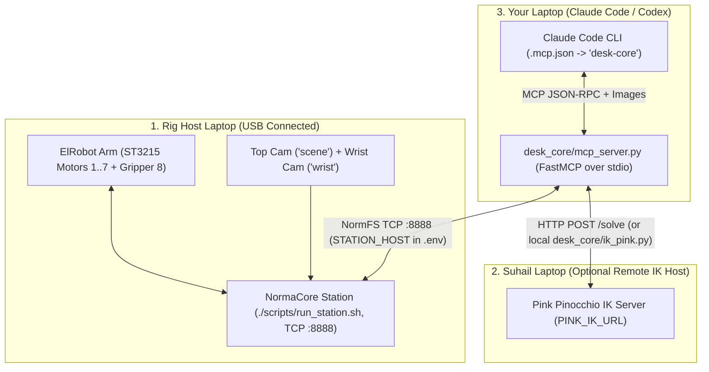
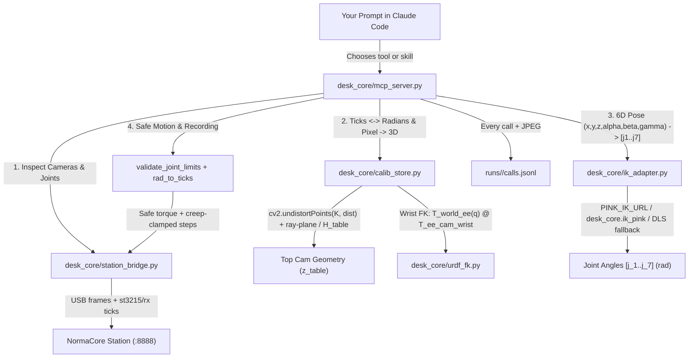

# DESK-CORE System Architecture & Claude Control Guide

How **Claude Code** (or **Codex**) talks to the **ElRobot 7-DoF + gripper** rig over MCP, using calibration, forward kinematics, and Suhail's **Pink IK** solver.

---

## 1. Network & Process Topology (Who Runs What)

Only **one laptop** (the Rig Host) connects by USB to the robot and cameras. Every other teammate laptop connects over the network to `:8888`.



---

## 2. Inside the MCP Server (Claude Prompt -> Robot Motion)

Whenever you type an instruction in Claude Code inside `norma-core`, Claude spawns `desk_core/mcp_server.py` (via `.mcp.json`) and chains these layers:



---

## 3. How You Command the Robot from Claude Code

### Step A — Start Claude Code in this repo
Claude reads `.mcp.json` automatically and starts the `desk-core` MCP server:

```bash
cd /Users/siddhartha/playarea/hackathons/normacore_hackathon/norma-core
claude
```

Check `.env` first:
- **Offline test (no hardware needed):** leave `STATION_HOST=` empty (or set `DESK_MOCK=1`).
- **Real robot:** set `STATION_HOST=<rig-host-ip>` (and optionally `PINK_IK_URL=http://<suhail-ip>:<port>/solve`).
- Hardware routing IDs (`bus_serial`, `camera_top`, `camera_wrist`) load automatically from `.env` or `calib/rig_calib.json`.

---

### Step B — Example Prompts & What Claude Actually Executes

#### 1. "Check the robot, show me what's on the desk, and tell me the current joint angles."
Claude calls:
1. `observe()` -> returns top + wrist camera images, link freshness (`rx_age_ms`), and all 8 servo positions.
2. `get_joint_angles()` -> converts ST3215 ticks to radians `[j_1, ..., j_7]` via `calib_store.py`.
3. `get_calib_status()` -> confirms whether `rig_calib.json` / `camera_calibration.json`, Pink IK, and `urdf_fk` are loaded.

#### 2. "Move joint 1 slightly to +0.2 rad and keep the other joints where they are, then go home."
Claude calls:
1. `get_joint_angles()` -> reads `[q1, q2, q3, q4, q5, q6, q7]`.
2. `move_joint(joints=[0.2, q2, q3, q4, q5, q6, q7])`:
   * Validates bounds against `elrobot_follower.urdf` / servo limits (returns `False` cleanly if unsafe).
   * Converts radians -> ticks (`rad_to_ticks`).
   * Enables torque safely (`GoalPosition = PresentPosition` first, caps speed/accel).
   * Creeps smoothly in bounded steps until settled (`True`), or aborts (`estop`).
3. `go_home()` -> returns all arm joints cleanly to safe midpoints.

#### 3. "Move the gripper to x=0.25m, y=0.05m, z=0.12m pointing straight down."
Claude calls either:
* `move_to_pose(x=0.25, y=0.05, z=0.12, alpha=0.0, beta=1.57, gamma=0.0)`
  *(which internally runs `solve_ik(...)` -> `move_joint(...)`)*, **or**
* Step-by-step: `solve_ik(...)` -> prints `[j_1..j_7]` -> `move_joint(joints=...)`.

#### 4. "Pick up the blue key fob without hitting the coffee mug, and put it in the departure tray."
Here is the full autonomous vision-to-grasp pipeline Claude runs:
1. `get_frame(camera="top")` -> gets image + `(H, W, 3)` matrix; Claude identifies pixel `(u_fob, v_fob)`, `(u_tray, v_tray)`, and `(u_mug, v_mug)`.
2. `pixel_to_world(u_mug, v_mug)` -> `update_scene_obstacle(name="mug", x=..., y=...)` so Pink IK plans around the mug.
3. `get_metric_depth(u_fob, v_fob, camera="top")` & `pixel_to_world(u_fob, v_fob, camera="top")` -> computes `(x, y, z)` in `base_link` meters using undistorted camera intrinsics + extrinsics.
4. `pick_at(x, y, z)` (or `pick_pixel(x=u_fob, y=v_fob)`):
   * `release()` -> opens jaws.
   * `solve_ik` + `move_joint` to hover `6 cm` above target.
   * Descend to grasp height -> `grasp()` -> verifies jaw slack (`holding=True` vs empty close).
   * Retract `6 cm` upward.
5. `pixel_to_world(u_tray, v_tray)` -> `place_at(x, y, z)` -> lowers, opens jaws, retracts, and calls `go_home()`.

#### 5. "Run a single atomic multi-step sequence" (Zero round-trip latency)
Claude can batch multiple calls in one `execute_sequence` MCP tool call with `$variable` chaining:
```json
[
  {"tool": "update_scene_obstacle", "args": {"name": "mug", "x": 0.25, "y": 0.0}},
  {"tool": "solve_ik", "args": {"x": 0.22, "y": -0.06, "z": 0.08, "beta": 1.57}, "save_as": "q_target"},
  {"tool": "move_joint", "args": {"joints": "$q_target"}},
  {"tool": "grasp", "args": {}},
  {"tool": "release", "args": {}}
]
```

---

## 4. Safety Guards & Debugging During Live Runs

* **Creep clamping & range clamp:** `move_joint` and `move_joints` never command huge single-step jumps; every command is clamped to servo `[range_min, range_max]` and `max_step`.
* **Stale telemetry lockout:** If Station restarts or drops frames (`> 10s`), `LiveStationBridge` automatically resubscribes NormFS streams and refuses motion commands until live ticks return.
* **Emergency stop anytime:** Say `"STOP"` / `"estop"` (or run `estop()`), holding present position (or dropping torque safely if telemetry is stale).
* **Full session replay:** Every Claude tool call and camera frame is saved under `runs/<UTC-timestamp>/`:
  ```bash
  uv run --offline --managed-python python scripts/replay_run.py --latest
  ```
