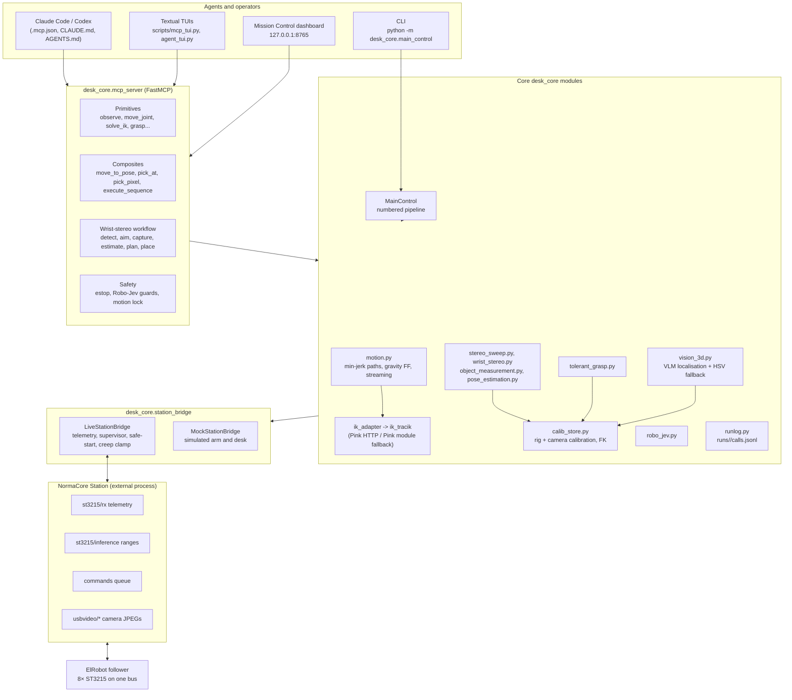
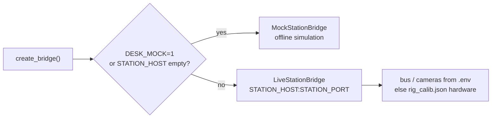
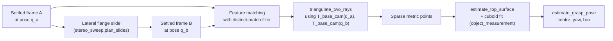
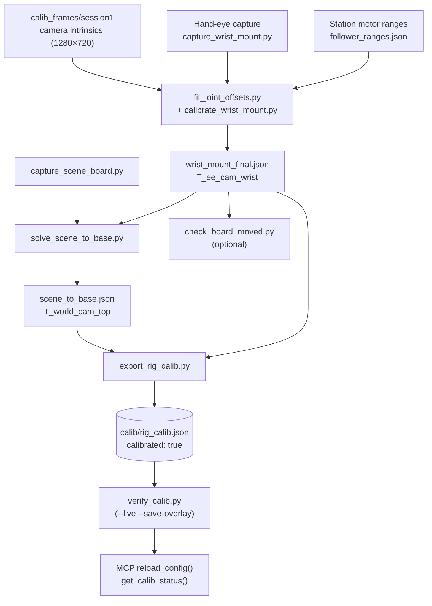

# DESK-CORE Technical Documentation

**Branch:** `feat/final` · **Robot:** ElRobot follower (7 arm joints + gripper, ST3215 servos) · **Platform:** NormaCore Station

DESK-CORE is the Python control layer our team built on top of NormaCore Station. It lets an agent (Claude Code, Codex, or the Textual TUI) observe a tabletop through two cameras, locate an object, estimate its metric 3D pose, plan collision-checked motion with TRAC-IK, and pick and place the object. Station supplies the hardware drivers, telemetry, and camera streams. This document covers the architecture, the techniques implemented, the calibration pipeline, the operator workflows, and the verified status at the end of the hackathon.

---

## 1. Scope and Terminology

| Term | Meaning |
|---|---|
| **Station** | NormaCore's runtime (`software/station/`). Owns the ST3215 bus, USB cameras, and NormFS queues. Serves TCP on port 8888 by default. |
| **Bridge** | `desk_core/station_bridge.py`. Hides Station behind one interface. `LiveStationBridge` talks to hardware; `MockStationBridge` simulates the arm and scene. |
| **MCP server** | `desk_core/mcp_server.py`. A FastMCP server exposing 40 tools and 2 prompt skills. This is the surface agents call. |
| **MainControl** | `desk_core/main_control.py`. The numbered pick-and-place workflow shared by the MCP tools and the CLI. |
| **Rig calibration** | `calib/rig_calib.json`. Joint zero offsets, signs, camera extrinsics, table height, gripper ticks, and home pose. |
| **Ticks** | ST3215 encoder units, 12-bit, 0–4095. One radian is `4096 / 2π ≈ 651.9` ticks. |
| **`T_A_B`** | A 4×4 transform that maps points in frame B into frame A: `p_A = T_A_B @ p_B`. |
| **Flange / TCP** | `Gripper_Base_v1_1` is the end-effector link. The tool centre point is offset from it by `TCP_IN_FLANGE`. |
| **Capture / stereo pair** | Two settled wrist-camera images taken from different poses, used for metric triangulation. |
| **Robo-Jev** | A deterministic sub-150 ms safety gatekeeper that checks frames, obstacles, and jaw telemetry, and can abort motion. |

---

## 2. System Architecture

### 2.1 Layered view



### 2.2 Repository map (DESK-CORE)

| Path | Role |
|---|---|
| `desk_core/mcp_server.py` | MCP tool and prompt definitions, motion lock, run logging. |
| `desk_core/station_bridge.py` | Live and mock bridges, telemetry supervisor, command safety. |
| `desk_core/main_control.py` | Numbered pick-and-place workflow and its CLI. |
| `desk_core/motion.py` | Flange move planning, minimum-jerk timing, gravity and friction feed-forward, streaming. |
| `desk_core/ik_adapter.py`, `ik_tracik.py`, `ik_pink.py`, `ik.py` | Inverse kinematics backends and the ElRobot model. |
| `desk_core/urdf_fk.py` | Forward kinematics from the URDF. |
| `desk_core/calib_store.py` | Calibration loading, tick ↔ radian conversion, camera rays, metric depth. |
| `desk_core/vision_3d.py`, `llm_plugins.py` | Vision-model localisation, provider registry, secure keystore, agent loop. |
| `desk_core/stereo_sweep.py`, `wrist_stereo.py` | Wrist sweep planning, stereo triangulation, dense clouds. |
| `desk_core/object_measurement.py`, `pose_estimation.py` | Object segmentation, cuboid fit, top-surface and grasp-pose estimation. |
| `desk_core/tolerant_grasp.py` | Tolerant top-down grasp planning with jaw collision boxes. |
| `desk_core/robo_jev.py` | Reflex gatekeeper. |
| `desk_core/dashboard.py`, `tts.py` | Mission Control web UI, speaker cues. |
| `desk_core/runlog.py` | Replayable tool-call logging. |
| `calib/` | `rig_calib.json` (active), `rig_calib.example.json` (schema), `fixed_positions.json`, `drop_location.json`, `gravity_ff.json`, the RViz config, and the calibration README. |
| `calib_frames/` | Captured calibration data (session1 intrinsics, hand-eye and scene captures, grasp experiments). Largely Git-ignored. |
| `scripts/` | Calibration tools, capture tools, smoke tests, TUIs, replay, plotting. |
| `tests/` | pytest suite for IK, motion, scripts, stereo sweep, and main control. |
| `docs/desk-core-handoff.md` | Hand-eye calibration handoff (snapshot from before this branch's final work). |
| `robot_setup.md`, `order.md`, `pose_estimation.md`, `epipolar.md` | Run log of the 2026-11-22 live sessions, pick-and-place step order, pose-estimation notes, epipolar notes. |
| `.claude/skills/desk-operator/`, `.codex/skills/desk-operator/` | Operator skill for agents. |
| `.mcp.json` | Registers the `desk-core` MCP server for Claude Code. |

### 2.3 Dependencies (from `pyproject.toml`)

Python 3.12 (`.python-version`). Runtime: `fastmcp`, `opencv-python`, `numpy`, `scipy`, `pytracik` (TRAC-IK), `pin` (Pinocchio), `mujoco`, `google-genai`, `fastapi` and `uvicorn`, `textual`, `edge-tts`, `pyttsx3`, `python-dotenv`. Dev group: `open3d` (point-cloud preview), `matplotlib`, `pytest`, `pytest-cov`. The station Python client `station_py` and the generated protobufs are imported from the NormaCore tree.

Run commands with `uv run --offline --managed-python python ...` from the repo root. The offline flags keep the environment reproducible on the rig.

---

## 3. Platform Layer: NormaCore Station and the Bridge

### 3.1 Station is required for live operation

Station owns the ST3215 serial bus and cameras, and it publishes telemetry to NormFS queues. DESK-CORE does not talk to the serial port. The bridge reads and writes through Station's TCP API.

| Station queue | Used for |
|---|---|
| `st3215/rx` | Live motor position and current (readable with torque off). |
| `st3215/inference` | Calibrated motor ranges (`range_min`, `range_max`). |
| `commands` | Goal position, speed, and acceleration writes. |
| `usbvideo/<md5(camera_unique_id)>` | JPEG frames for the top and wrist cameras. |
| `inference-states` | Used to discover cameras remotely. |

The `.env` variables `STATION_HOST`, `STATION_PORT`, `STATION_BUS_SERIAL`, `CAMERA_TOP`, and `CAMERA_WRIST` select the rig. If `rig_calib.json` has `hardware` entries, they fill in the blanks.

### 3.2 Bridge selection



**Important:** if `STATION_HOST` is unset, `_get_bridge()` silently uses the mock. The 2026-11-22 run log records two "go home" runs that appeared to succeed but moved nothing. Always check the bridge type before commanding motion. Set `STATION_HOST=127.0.0.1 STATION_PORT=8888` for the live rig, and confirm the bridge reported by `observe()` says `"bridge": "live"` (the smoke test prints `"bridge": "mock"` when offline).

### 3.3 Safety in the bridge

Implemented in `LiveStationBridge` (`station_bridge.py`):

| Mechanism | Implementation |
|---|---|
| Safe-start torque | Writes `GoalPosition = PresentPosition` before `TorqueEnable = 1`, so the arm does not jump when torque turns on. |
| Speed and acceleration caps | `DEFAULT_SPEED = 600`, `DEFAULT_ACCEL = 20`, configurable through `ROBOT_GOAL_SPEED` and `ROBOT_GOAL_ACCEL`. |
| Creep limit | Each `move_joints` call may move a motor at most `ROBOT_MAX_STEP_TICKS` (code default 400; the `.env.example` suggests 250). |
| Calibrated range clamp | Every goal is clamped to the motor's `range_min`/`range_max` from `st3215/inference`. |
| Telemetry freshness | Motion is refused if the newest telemetry is older than `ROBOT_MAX_CMD_STALE_S` (10 s). The RX fresh window is 0.5 s for raw state. |
| Stream supervisor | If Station restarts, NormFS subscriptions die. A supervisor task rebuilds them after `ROBOT_STALE_RESUB_S` (8 s) of silence and blocks motion until the link is healthy. |
| E-stop | `abort()` holds the current position. It does not cut torque, so the arm stays under control. |
| Grip detection | A gripper is "holding" only when its position stays at least `GRIPPER_SLACK_STEPS` (120) away from the closed setpoint. |

### 3.4 Mock bridge

`MockStationBridge` simulates the arm and a desk scene (mug and tray, registered via `mock_add_object`), renders `mock_frames/`, and supports `mock_displace_object` for Robo-Jev tests. Tests run against it by default (`DESK_MOCK=1` forces it).

---

## 4. MCP Server

### 4.1 Tool groups

Tool names are the public contract. Agents should call them by name.

| Group | Tools |
|---|---|
| **Observation** | `observe(views, denoise)`, `get_state`, `get_frame(camera)`, `get_joint_angles(include_gripper)`, `get_calib_status`, `reload_config` |
| **Bare-metal control** | `set_torque`, `move_joints(targets, max_step, wait)`, `move_joint(...)`, `grasp(close_ticks)`, `release`, `go_home`, `move_to_home(max_step, timeout_s)`, `estop` |
| **Kinematics and 3D** | `solve_ik(x, y, z, qx, qy, qz, qw)`, `get_metric_depth(x, y, camera, q_rad)`, `pixel_to_world(...)`, `localize_3d(...)` |
| **Composite motion** | `plan_and_move` and `sweep_aside` (MuJoCo preflight; dry run unless `execute=True`), `move_to_pose`, `move_flange` (dry run unless `execute=True`), `pick_at`, `place_at`, `pick_pixel(x, y, yaw)`, `execute_sequence(steps, stop_on_false)` |
| **Wrist-stereo pipeline** | `detect_requested_object`, `aim_wrist`, `capture_wrist_stereo`, `estimate_wrist_depth`, `measure_graspability`, `estimate_grasp_pose` (legacy), `plan_tolerant_grasp`, `retract_to_hover`, `move_to_drop`, `master_pick_place` |
| **Wrist final approach** | `servo_align_wrist(tol_mm=1.5)` |
| **Safety and scene** | `update_scene_obstacle`, `robo_jev_arm_watch`, `robo_jev_check`, `robo_jev_guard`, `speak_status` |
| **Mock helpers** | `mock_add_object`, `mock_scene_state`, `mock_reset_scene` |

Prompt skills: `desk_operator_skill`, `pick_and_place_skill`.

`plan_and_move` takes a flange pose in `base_link` (meters, xyzw quaternion) and an explicit
`shoulder_torque_limit_nm` simulation budget. It checks the ElRobot URDF collision geometry against the
tabletop and obstacles registered with `update_scene_obstacle` (center coordinates; boxes require
`size_xyz` full dimensions). It also checks the modeled gravity moment about j2 at each sampled waypoint,
including the quantized tick targets. Lifts involving j2 first move j3 and j4 to reduce the shoulder load.
It rejects paths that do not clear these checks without issuing a joint target.

`execute=True` can send the checked targets to the mock bridge or the live ElRobot bus named in the
rig calibration. Both live preview and execution require fresh, fault-free telemetry, explicit calibrated joint signs
and zeros, the same effective motor ranges, and an unloaded gripper within 25 ticks
of its calibrated open limit. MuJoCo uses the measured jaw opening and holds it fixed for the move.
Live execution also requires arm torque to be already enabled. The planner uses the same tick↔radian
conversion as Desk Core FK; Station refuses to clamp or send
a target from a different measured pose. After the first command establishes the inactive joints'
initial targets, each later command updates only one joint; the others keep their last targets instead
of following measured sag. The planner samples each segment from the stable measured pose to the full
commanded vector, including any residual error toward retained targets. Settling uses the same 15-tick
tolerance as the flange-motion stream and requires measured progress unless the active joint settles
within one encoder tick of its target. The model does not account for physical overshoot or different
rates of residual motion.
On a stall or an unconfirmed target write, Station attempts to hold the measured position.
The model does not account for payload or dynamic torque. A simulation budget is not a hardware rating.
To request just the MuJoCo IK solution, pass the same limit to `solve_ik`; without it the existing IK
backend is unchanged.

`servo_align_wrist` moves at the current hover height without closing the jaws. Start with the open
gripper pointing down and an isolated, elongated, saturated-color marker near the center of the wrist
view. It projects the marker to the calibrated table plane, centers the camera's optical ray there, and
turns the jaws perpendicular to the marker's long axis. It uses local CPU vision at a target rate of
10 Hz, caps the centering tolerance at 0.99 mm, and requires yaw within 2° before returning success.
Large initial yaw errors trigger a wrist-only pre-rotation. MuJoCo checks the entire roll path before
Station moves; the 1.5 s fine-alignment deadline starts after that pre-rotation. The result reports
`prerotation_s`, `ibvs_s`, and total `elapsed_s`. Live Station feedback and settling can reduce the
update rate. For live use, configure the measured wrist calibration and camera ID, enable arm
torque, and set an appropriate `shoulder_torque_limit_nm` model budget in the active rig JSON.

Use `sweep_aside(start_xy, end_xy, z_mm)` to push a rolling marker instead of grasping it.
XY points are jaw-tip midpoint coordinates in `base_link` meters. `z_mm` is the clearance from the
calibrated top of the desk mat to the lowest jaw, not the flange height or a camera depth.
Start behind the marker and choose an end point in the side pen zone. Register obstacles along the
route, but leave the intended push target out of the obstacle list. The open jaws approach from above,
descend, sweep at constant height, and lift vertically. It preflights the entire route with the same
collision and shoulder holding-torque checks (`shoulder_torque_limit_nm` defaults to 0.6 N·m).
Call again with `execute=True` to move, then re-observe to confirm the marker arrived; a successful
return confirms arm motion, not the marker's position. Calibrate the tabletop to the mat surface first.

The rolling-marker contact test can be run without hardware with `uv run pytest -s tests/test_sweep_aside.py`.
It drives the ElRobot collision geometry with the live bridge's single-joint commands and simulated encoder feedback.

### 4.2 Motion lock and run log

- **`_motion_tool` decorator.** All motion tools serialize through one asyncio lock. A nested call from the same task is allowed. A concurrent call raises "Another desk-core motion operation is running." `move_flange` returns a structured "not executed" result instead. An estop in progress blocks new motion.
- **`_traced` decorator and `runlog.py`.** Every call writes an entry to `runs/<UTC>-<pid>/calls.jsonl` (args, result or error, duration), and `observe()` frames go to `frames/`. Lines are fsynced, so a crash still leaves a usable trail. Set `DESK_RUNLOG=0` to disable. `calls.jsonl` can be replayed through `scripts/replay_run.py`.

---

## 5. Techniques Implemented

### 5.1 Calibration model

The calibration contract is documented in `calib/README.md`.

**Joint mapping.** Each arm joint has a zero tick and a sign:

```
angle_rad = joint_signs[i] * (tick - joint_zero_ticks[i]) / TICKS_PER_RAD
TICKS_PER_RAD = 4096 / (2π)
```

Active rig values (`calib/rig_calib.json`): zero ticks `[2048, 2048, 2048, 2048, 1845, 1927, 2200]` for motors 1–7, all signs `+1`. Motor 8 is the gripper, with open at 2864 and close at 1232.

**Camera calibration.** Intrinsics come from `calib_frames/session1/camera_calibration.json` (1280×720). Undistortion uses `cv2.undistortPoints` with the OpenCV 5-element distortion vector. Reprojection RMS was 0.181 px (wrist) and 0.240 px (scene).

**Transforms:**

| Transform | Meaning | Source |
|---|---|---|
| `T_world_cam_top` | Fixed scene camera → `base_link` | Scene-to-base recovery (`recover_scene_to_base.py`, `solve_scene_to_base.py`) |
| `T_ee_cam_wrist` | Wrist optical frame → `Gripper_Base_v1_1` | Hand-eye solve (`calibrate_wrist_mount.py`, `fit_joint_offsets.py`) |
| `T_base_cam_wrist(q)` | `T_base_ee(q) @ T_ee_cam_wrist` | Runtime, using URDF FK |
| `H_table`, `z_table` | Tabletop homography and height in base metres (`z_table = 0.00237`) | Board capture |

**Forward kinematics.** `urdf_fk.py` evaluates the chain from `hardware/elrobot/simulation/elrobot_follower.urdf`. Wrist FK recomputes the camera pose for every frame, so the wrist view stays metric while the arm moves.

**Pixel → world.** `CalibrationStore.pixel_to_world` undistorts the pixel, casts a ray through the camera model, and intersects it with the tabletop plane at `z_table` (or uses `H_table`). `get_metric_depth` uses the same ray-plane intersection, so it is calibrated and not a learned estimate.

### 5.2 Inverse kinematics

Backend order (`ik_adapter.py`):

1. HTTP Pink service if `PINK_IK_URL` is set.
2. **TRAC-IK** (`ik_tracik.py`, `pytracik`), bounded by the motor ranges from Station, converted to radians.
3. Local `ik_pink.py` module exposing `solve_ik(...)`.
4. Otherwise an error.

TRAC-IK results are verified with FK before they are returned: position error ≤ 0.5 mm and rotation error ≤ 0.3°. A solution is never returned if it misses the target by more than that, which is why the composite tools are preferred over raw IK guesses.

The ElRobot model in `ik.py` removes the gripper for the arm-only solve, adds a table collision box (`ik_table`), checks self-collision with a 1 mm margin, and converts orientations to quaternions.

### 5.3 Motion planning and execution

`motion.py` implements the Cartesian motion path:

| Step | Technique |
|---|---|
| Path | Straight-line flange path in Cartesian space, sampled into joint waypoints. Each waypoint is solved with TRAC-IK. |
| Timing | **Minimum-jerk** profile (`min_jerk(tau)`), so velocity and acceleration start and end at zero. |
| Limits | `MotionLimits`: linear speed (default 3 cm/s in `FAST_LIMITS`), rotation speed (30 °/s), joint speed (45 °/s), minimum duration, lag limit (120 ticks), and max step (300 ticks). `RANGE_MARGIN_TICKS = 50` keeps targets away from the range ends. |
| Gravity feed-forward | `gravity_torque(q)` from the URDF dynamics, scaled by fitted gains in `calib/gravity_ff.json` and clipped to `GRAVITY_FF_MAX_RAD = 0.15` rad of offset. `fit_gravity_ff.py` refits the gains after payload changes. |
| Friction feed-forward | Per-waypoint friction compensation, added with the latest refit. |
| End-pose correction | After the path, `flange_error` measures the residual and corrects the final pose. |
| Height check | `HEIGHT_CHECK_LINKS` (`ST3215_3`, `ST3215_5`, `ST3215_7`, and the tool frame) must stay above the table. `lowest_point_m` checks this for every waypoint. |
| Streaming | `stream_joint_path` sends waypoints and checks each leg against fresh telemetry. It stops and reports if a joint lags beyond the limit. |

`move_flange` is a dry run unless `execute=True`. It returns the planned path, the error estimate, and any problems, without moving the arm.

### 5.4 Grasp planning

**Top-down pick.** `main_control.py` builds the grasp from the measured object (centre, yaw, width, length, height) and the tool definition (`tcp_offset_m`, `tool_quaternion_xyzw`, `reference_jaw_yaw_deg`, `jaw_opening_mm`).

**Tolerant grasp** (`tolerant_grasp.py`): wide jaws self-centre the object as they close. The planner exploits this:

- `grasp_tolerances(width, length, opening)` gives the allowed slack along the closing axis (`(opening − width)/2 − 2 mm`) and the allowed heading deviation.
- Bounded least-squares IK over the seven joints solves for the hover and contact poses. The residual uses dead-zone terms, so anything inside the tolerance costs nothing.
- Every corner of both jaw collision boxes (the closed and open URDF meshes, transformed by the flange pose and the jaw transform) must stay 8 mm above the table at the grasp: 5 mm clearance plus 3 mm for gravity sag.
- The planner returns a vertical hover pose, the contact pose, and a clear joint path.

### 5.5 Object localisation

Two paths feed `localize_3d`:

- **Vision model:** `vision_3d.py` sends the top image to a configured vision-only model. Supported providers: Gemini (default model `gemini-4-hydrogen`), Anthropic Claude, OpenAI-compatible endpoints (including Qwen and DeepSeek). The model returns a normalised `[y, x]` point, a `box_2d` (0–1000), and a yaw. Each reply is parsed against a Pydantic schema.
- **OpenCV fallback:** `localize_opencv` uses HSV thresholds and contour search. `build_orange_horn_mask` masks out the ElRobot's orange servo horns and brackets, so they are not mistaken for targets. The fallback runs when no key is configured, when `use_gemini=False`, or when the API call fails or times out.

`localize_object_3d_dual` combines both cameras when the wrist view is available. Both paths end with `pixel_to_world` (§5.1).

**Vision keystore.** `llm_plugins.py` allows only vision-capable providers and models. Keys are stored in `~/.config/desk-core/keys.json` with `0600` permissions, and they are never logged or committed. The dashboard and TUI can set or unset keys.

### 5.6 Wrist-stereo metric depth

The wrist camera is on the flange, so moving the flange moves the camera by a known amount. The pipeline turns that into a depth measurement:



Key details from `stereo_sweep.py` and `wrist_stereo.py`:

- **Slide planning.** `plan_slides` picks a direction perpendicular to the optical axis. It sizes the slide for a target parallax and keeps the target inside the frame (`max_slide_in_frame`). `rank_slides` prefers slides that swing the joints least, because large swings amplify kinematic error.
- **Relative pose refinement.** `refine_relative_pose` polishes the rotation and translation between the two views with a Sampson-error objective. The arm-derived pose is only the starting point.
- **Sparse triangulation.** `triangulate_matches` converts matched pixels into rays in base coordinates and intersects them. `estimate_wrist_depth` requires at least 4 distinct matches, and it checks the wrist detection against the scene projection.
- **Table plane.** `fit_table_plane` fits the tabletop with a tilt limit of 25° and tolerance 3 mm. `align_pose` corrects the scale and orientation.
- **Dense clouds.** `dense_cloud` produces coloured points in the depth range 0.08–0.8 m. `write_ply` writes a PLY file, and `build_cloud=True` previews it with Open3D.
- **Object measurement.** `object_measurement.py` segments the object (colour mask, GrabCut, or both) and fits a cuboid. Both segmentation methods must agree before the fit is trusted.

`wrist_stereo.py` and `stereo_sweep.py` also expose the sweep as a CLI (`scripts/wrist_stereo_sweep.py`), with fallback slide directions and dense clouds, which the 2026-11-22 run log found more robust than the single slide in `capture_wrist_stereo`.

### 5.7 Hand-eye calibration

Procedure implemented in `scripts/capture_wrist_mount.py`, `calibrate_wrist_mount.py`, and `fit_joint_offsets.py`:

1. **Capture.** A fixed checkerboard (10×7 inner corners, 15 mm squares) is viewed by the wrist camera at many flange poses. The tool saves the unannotated JPEG and records the seven joint ticks and receipt times.
2. **READY gate.** Capture requires all seven motors to be fresh (under 0.35 s old), the pose steady for 0.7 s (within 3 ticks per joint), the wrist frame during the hold, and a pose at least 25 ticks different from every saved pose.
3. **Solve.** OpenCV's Park hand-eye method computes `T_ee_cam_wrist` from the board detections and FK flange poses. `fit_joint_offsets.py` also refits the joint zero offsets from the same samples.
4. **Validate.** `check_board_moved.py` tests whether the board stayed put. `verify_calib.py` checks the calibration schema, SO(3) validity, `H_table` agreement, joint zeros, and wrist FK.

Recorded results: the wrist mount was refit on 19 poses, and a 4-pose held-out validation was run. These are in the calibration commit history. The handoff (`docs/desk-core-handoff.md`) recommends that held-out accuracy be re-checked after any mount change.

### 5.8 Safety: Robo-Jev reflex gatekeeper

`robo_jev.py` runs deterministic CPU checks in under 150 ms, separate from the LLM planner:

| Check | Trigger | Default threshold |
|---|---|---|
| `target_shifted` | Target moved sideways (template correlation and ROI delta), or vanished | 18 px or 22 mm |
| `grasp_secure` | Jaw slack and motor current score | Score 0.95 holding, 0.25 not |
| `will_tip` | Proximity to fragile obstacles (for example a mug) or a high-aspect target | Margin-based |
| `path_clear` | 2D segment from end effector to target intersects a registered obstacle | Geometric |

Arm a localized target with `robo_jev_arm_watch` before starting a reach. Use separate top and wrist pixels and the same query when the object is visible in both views. `master_pick_place` arms the top view at scene localization and adds the wrist crop once stereo confirms the target. A wrist watch uses the current joint pose to account for camera translation in the image.

Armed crops are checked while streaming, independently of the agent. A hazard calls `bridge.abort(source="reflex")` and ends the interrupted trajectory. If Robo-Jev has already latched the stop, the agent calls `observe()` before `robo_jev_guard` (also available from the dashboard), then plans a new reach from the stopped pose after successful recovery. Observing the cameras does not clear a reflex stop, and guarded recovery cannot clear a manual E-stop. If the agent notices a shift or stall before Robo-Jev stops the arm, call `estop()` immediately and re-observe.

### 5.9 Replay and observability

- Every MCP call is logged (§4.2). `scripts/replay_run.py` replays a `calls.jsonl` against the mock or the live bridge.
- The dashboard (`desk_core/dashboard.py`, `http://127.0.0.1:8765`) shows live top and wrist feeds, Robo-Jev meters, joint telemetry, link health, the tool-call log tail (`GET /api/logs`), and an E-stop button (`POST /api/estop`).
- `scripts/plot_trace.py` and `trace_infinity.py` plot motion traces.

---

## 6. Calibration Pipeline (Operator View)

Regenerate calibration when any of these change: motor ranges or servo offsets (after auto-calibration or reset), the wrist camera mount, the scene camera position, or the stream resolution.



Commands are listed in `calib/README.md`. A few notes:

- The board must not move between the hand-eye capture and the scene-to-base solve.
- `reload_config()` picks up changes without restarting the MCP server.
- `get_calib_status()` shows the active file, the transforms present, and any missing fields.
- `DESK_CALIB_PATH` overrides which file is loaded. Otherwise the store prefers a calibrated `rig_calib.json`, then the newest session camera calibration, then the nominal template.

---

## 7. Operator Workflows

### 7.1 Start the MCP server (for an agent)

`.mcp.json` registers the server for Claude Code:

```json
{
  "mcpServers": {
    "desk-core": {
      "command": "uv",
      "args": ["run", "--offline", "--managed-python", "python", "-m", "desk_core.mcp_server"]
    }
  }
}
```

Set `.env` for the rig, then start the agent in the repo root. The agent should read `AGENTS.md` (or `CLAUDE.md`) and the `desk-operator` skill first.

### 7.2 Standard task procedure

From `.claude/skills/desk-operator/SKILL.md` and `AGENTS.md`:

1. `observe(views=["top", "wrist"])`. Check `link.rx_age_ms` and that both cameras return frames. Confirm the bridge type.
2. `get_calib_status()`. Confirm `calibrated` and the transforms in use.
3. Register tabletop obstacles (mug, tray) with `update_scene_obstacle()` before any motion.
4. Prefer composites: `pick_pixel(x, y, yaw)` for a simple pick from image coordinates, `place_at(x, y, z)` to carry to the tray, then `go_home()`. Use `solve_ik → move_joint` only when a composite cannot express the move.
5. If `move_joint` returns `False`, or `grasp` reports `holding=False`, call `release()`, `observe()`, and retry. Call `estop()` on any hazard.

### 7.3 Pick-and-place from the CLI

```bash
# Dry run: detect, localise and aim the wrist. Does not move the arm.
uv run --offline --managed-python python -m desk_core.main_control "red block"

# Live execution. Requires a grasp tool definition and any obstacles.
uv run --offline --managed-python python -m desk_core.main_control "earbuds case" \
  --execute --tool /path/to/grasp_tool.json --obstacles /path/to/obstacles.json
```

Stages (`order.md`, `main_control.py`):

| Step | Stage | What it does |
|---|---|---|
| 1 | `observe` | Both cameras and telemetry. |
| 2 | `detect_requested_object` | Localise the object (`localize_3d` on the top camera). |
| 2 | `validate_setup` | Check the tool parameters and the follower state. |
| 3 | `aim_wrist` | Bring the object to the **middle** of the wrist frame, not just "visible". |
| 4 | `capture_wrist_stereo` | Settled frame, lateral move, second settled frame. |
| 4 | `estimate_wrist_depth` | Confirm the target in the reference frame, triangulate, fit the top surface. |
| 5 | `measure_graspability` | Footprint and jaw-gap check across the object. |
| 6 | `plan_tolerant_grasp` | Hover and contact joints, jaw collision boxes clear of the table. |
| 6 | `check_motion_paths` | Validate joint limits and collision-check every route. |
| 7 | `pick` | `release` → move to hover and contact → `grasp` → `retract_to_hover`. |
| 8 | `place` | `move_to_drop` replays saved `calib/drop_location.json` ticks with the object held, then `release`. |
| 9 | `home` | Return to saved home ticks and gripper. |

On failure, the controller calls `estop()` and `observe()`, and returns `failed_step` with a timing trace.

The alternative to the single wrist slide is the sweep:

```bash
python3 scripts/wrist_stereo_sweep.py --target 537 275 --roi 470 170 140 210 \
  --execute --out calib_frames/grasp_run/sweep
python3 scripts/measure_object.py ...   # cuboid and gripper-fit from the sweep
```

Centre the object in the wrist image first (`--object X Y Z` or `--target U V` on the object's pixel).

### 7.4 Motion from the agent (primitives)

- `move_to_home(max_step=80)` moves by direct joint ticks, with no IK. It is the most reliable way to return to home.
- `move_to_pose(...)` and `move_flange(..., execute=True)` run the smooth Cartesian planner (§5.3).
- `solve_ik(x, y, z, alpha, beta, gamma)` returns seven radians, and `move_joint(joints)` returns `True` or `False`.
- `execute_sequence(steps)` chains tool calls and stops on the first `False` (when `stop_on_false=True`).

### 7.5 Hand-eye capture (live)

Keep Station and the viewer running. The capture sends no motor or torque commands.

```bash
python3 scripts/capture_wrist_mount.py calib_frames/hand_eye_next \
  --host 127.0.0.1 --port 8888 \
  --bus <follower_bus_serial> --camera <wrist_camera_id>
```

1. Fix the board. Pick one physical corner as the origin for the whole session.
2. Pose the follower with the full grid visible. Wait for **READY**, then press **Space**.
3. Collect 15–20 samples with varied flange orientations, not just translation.
4. Press **q** or **Esc** to finish. Use `--resume` to add more samples later.

Copy `samples.json` **and its JPEGs** together when handing data to a teammate.

### 7.6 Dashboard and TUIs

```bash
uv run --offline --managed-python python -m desk_core.dashboard     # http://127.0.0.1:8765
uv run --offline --managed-python python scripts/mcp_tui.py
uv run --offline --managed-python python scripts/agent_tui.py --mock   # or --live
```

The agent TUI supports voice input (VAD-gated recording), neural TTS (edge-tts), a secure key modal, and output modes (audio, text, or both). The dashboard includes a 07:30 "First-Light" routine, a button that runs the morning checks (`POST /api/first_light`).

### 7.7 Verification (run before motion)

| Command | Purpose |
|---|---|
| `uv run --offline --managed-python pytest -q` | Unit suite (IK, motion, scripts, stereo sweep, main control). |
| `uv run --offline --managed-python python scripts/test_reconnect.py` | Supervisor rebuilds subscriptions and refuses stale motion. |
| `uv run --offline --managed-python python scripts/mcp_smoke.py` | Live or mock end-to-end MCP session. Add `--live` for the rig. |
| `uv run --offline --managed-python python scripts/test_primitives.py` | Primitive and composite checks. |
| `uv run --offline --managed-python python scripts/verify_calib.py` | Calibration schema, transforms, and FK. Add `--live --save-overlay` to project the base onto the top image. |

### 7.8 Replay a session

```bash
python3 scripts/replay_run.py runs/<timestamp>-<pid>/calls.jsonl
```

Each recorded call is replayed in order through an MCP client session, against whichever bridge is active.

---

## 8. Verified Status (end of hackathon)

Results from running the verification commands on `feat/final` at the time of writing (macOS, offline, mock bridge unless noted):

| Check | Result |
|---|---|
| `pytest -q` | **85 passed** (1 warning from a third-party plugin). |
| `test_reconnect.py` | **PASS**: supervisor rebuilds subscriptions and refuses stale motion. |
| `verify_calib.py` | **PASS**: 0 errors, 0 warnings. Wrist FK and tick conversion verified. |
| `test_primitives.py` | **FAIL, 1 check**: `execute_sequence composite pipeline passes` (4 of 5 steps passed). Investigate before relying on `execute_sequence`. |
| `mcp_smoke.py` (mock) | **FAIL, 1 check**: `release opens jaws` in the mock. The other 8 tools and `grasp` verification pass. |

Live rig status, from `robot_setup.md` (2026-11-22):

- Live telemetry, both cameras, and motion through Station were confirmed. A real move to home completed within 40 ticks, with `move_to_home(max_step=80)` taking about 4 s.
- Scene localisation placed the earbuds case at about (−0.107, −0.225) m in base coordinates, which matched the top-camera estimate within about 2 cm.
- The end-to-end pick-and-place of the earbuds case was **not completed**. The arm placed the object in a failed state (not held) after a sequence of issues recorded in the run log:
  - `aim_wrist` could not find a viewing pose when the target was close to the base.
  - Jaws occluded the object in the wrist view, and a glossy black object gave no feature matches.
  - Each gripper command moves at most `ROBOT_MAX_STEP_TICKS`, so one close command only closes the jaws partway. A repeated-step close gave a secure grip in one test (`grasp_earbud3`). The grasp check still reports `holding=True` from position alone, which cannot tell a stalled jaw from a held object.
  - A joint stalled for 60 s during a move, which left the tips above the table.
- Approved changes from that session: stereo final-pose tolerance raised from 25 to 40 ticks (`stereo_sweep.py`), and the wrist ROI check relaxed to 80 px (`main_control.py`).

Hand-eye calibration status: the capture workflow and offline solve work, and `rig_calib.json` is marked `calibrated: true`. Held-out validation of the wrist mount on this arm is still the open item in the handoff.

---

## 9. Safety Summary

- **Software safeguards:** safe-start torque, speed and acceleration caps, the per-call creep limit, calibrated range clamp, telemetry freshness gate, stream supervisor, and the E-stop that holds position without cutting torque.
- **Motion gates:** the motion lock, the joint-limit and collision checks (`_validate_goal`, `_checked_path`), the table clearance (5 mm plus 3 mm sag), and the height check on each link.
- **Reflex layer:** Robo-Jev aborts on target shift, vanished target, unsafe grasp, tipping risk, and path obstruction.
- **Operator rules:** observe first, register obstacles before moving, prefer composites, `estop()` on any shift or stall, and confirm the bridge type before commanding the arm.
- **Not a substitute for:** a physical emergency stop, a hard-wired power cutoff, or supervised first runs. Keep a hand near the power switch for any new motion.

---

## 10. Known Limitations and Open Items

| Item | Detail |
|---|---|
| Failing checks | `test_primitives` (`execute_sequence`) and `mcp_smoke` (mock `release`). Both are open. |
| Grip detection | Holding is inferred from jaw position. It needs a current or gap-change check. |
| Gripper step | Each command moves at most `ROBOT_MAX_STEP_TICKS`, so closing takes repeated steps. Ensure the `.env` value and the code default (400 vs 250) are reconciled. |
| Wrist viewing | `aim_wrist` cannot always find a pose for targets near the base. Shadowed or glossy objects give no stereo features. |
| Hand-eye accuracy | Held-out accuracy on the real mount is not yet demonstrated. |
| Top-camera error | About 2 cm at the workspace edge. The wrist ROI check was relaxed to compensate. |
| Environment | `uv run` creates `.venv` on first use. Generated `runs/` and `calib_frames/` contents are Git-ignored. |
| Docs | `docs/desk-core-handoff.md` describes an earlier snapshot (`feat/metric_depth_estimation`). This document reflects `feat/final`. |

---

## 11. References

- Operator guide: `AGENTS.md`, `CLAUDE.md`, `.claude/skills/desk-operator/SKILL.md`
- Calibration contract: `calib/README.md`, `calib/rig_calib.example.json`
- Hand-eye handoff: `docs/desk-core-handoff.md`
- Live run log (2026-11-22): `robot_setup.md`
- Pick-and-place step order: `order.md`
- Pose estimation and epipolar notes: `pose_estimation.md`, `epipolar.md`
- Station platform: `software/station/bin/station/README.md`, `hardware/elrobot/README.md`
- Follower URDF: `hardware/elrobot/simulation/elrobot_follower.urdf`
